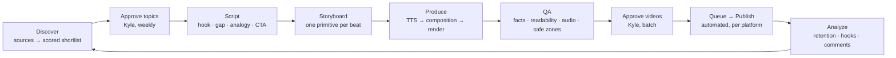

# helena_loves_you — workflow package

New technology, explained simply, by Helena — a synthetic human whose purpose is to facilitate human progress. Five short videos a week (workdays) on Instagram Reels, TikTok and YouTube Shorts; faceless (her voice, her register, and a voice visualizer carry her); music + SFX; 40–60 s; HTML-rendered in an uncanny clinical white.

This repo is the operating manual for the account — for Kyle and for an AI agent running the same steps. Nothing here is theory for its own sake: every document is either an SOP (do this), a reference (look this up), or a template (fill this in).

## The workflow in one picture

Two cadences run at once (`docs/00-cadence.md`):

- **Evergreen batch** — ~3 slots/week ("how X actually works"). Produced in bulk, mid-month for the following month, from a bank that never runs dry.
- **Hot slots** — ~2 slots/week filled within 48 hours of something new landing (a model release, a repo going vertical). Produced one at a time.

Both end in the same approved queue and the same publisher.

## Documents

| #   | Doc                                                         | What it is                                                                                                          |
| --- | ----------------------------------------------------------- | ------------------------------------------------------------------------------------------------------------------- |
| 00  | [Cadence & operating rhythm](docs/00-cadence.md)            | Weekly/monthly rhythm, who does what, time budgets                                                                  |
| 01  | [Brand, audience & voice](docs/01-brand-audience-voice.md)  | Who Helena is (the bible), who it's for, her register, the tone guardrail                                           |
| 02  | [Visual design system](docs/02-visual-design-system.md)     | The Helena palette, frame chrome, slow-flat motion, the voice visualizer, captions; type test in `docs/aesthetics/` |
| 03  | [Topic discovery & scoring](docs/03-topic-discovery.md)     | Sources, velocity signals, scoring rubric, the shortlist ritual                                                     |
| 04  | [Script framework](docs/04-script-framework.md)             | Hook library, the gap structure, analogy method, CTA, word budgets                                                  |
| 05  | [Visual storytelling](docs/05-visual-storytelling.md)       | Mapping script beats to diagram primitives, reveal rules, narration sync                                            |
| 06  | [Production pipeline](docs/06-production-pipeline.md)       | Tool stack, project folder, composition contract, TTS → captions → render                                           |
| 07  | [QA checklist](docs/07-qa-checklist.md)                     | The gate before anything is marked approved                                                                         |
| 08  | [Publishing & scheduling](docs/08-publishing-scheduling.md) | Per-platform specs, caption packs, the self-built queue + publisher, approval gate                                  |
| 09  | [Analytics & iteration](docs/09-analytics-iteration.md)     | What to measure, the weekly review, how learnings flow back into 03/04                                              |
| 10  | [Decision log](docs/10-decision-log.md)                     | Open experiments (aesthetic, TTS, renderer…), what was tested, what was decided                                     |

`docs/research/` holds the research reports the decisions are based on.

## Templates

`templates/` — `topic-brief.md`, `script.md`, `shot-list.md`, `caption-pack.md`, `video-README.md`. Each video's project folder carries filled-in copies in its `Docs/`.

## Agent skills

`skills/` — one SKILL.md per stage so an agent can run a stage on its own:

| Skill              | Stage               | Output                                                                         |
| ------------------ | ------------------- | ------------------------------------------------------------------------------ |
| `/helena-discover` | Discover            | `pipeline/discover/shortlist-YYYY-WW.md` + candidates in `topics.json`         |
| `/helena-script`   | Script + storyboard | `Docs/brief.md`, `Docs/script.md`, `Docs/shot-list.md` in a new project folder |
| `/helena-produce`  | Produce             | the rendered video, poster, textless master, assets                            |
| `/helena-qa`       | QA                  | `Docs/qa.md` with pass/fail per check                                          |
| `/helena-publish`  | Publish             | queue entry → posted on the three platforms                                    |
| `/helena-review`   | Analyze             | weekly `docs/reviews/YYYY-WW.md` and updates to the hook library / rubric      |

`CLAUDE.md` is the agent entrypoint: it says which docs to read for which stage.

## Companion repo: the media library

Reusable building blocks (Helena's brand kit, diagram primitives, the voice visualizer, caption renderer, music beds, render pipeline) live in a separate repo, `helena-media-library`, organised like the Gaijin Motorsports library (`INDEX.md` → `ASSET.md` per asset, plumbing vs creative, `used_in`). See `docs/06-production-pipeline.md` § Media library.

## Status

Type family, visualizer style, voice, music and the publisher are still **in test** — see the decision log before assuming a choice is final.
