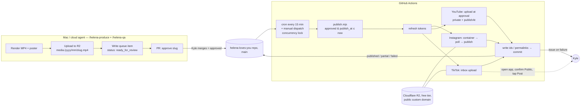

# 08 — Publishing & scheduling

Goal: an approved video posts itself natively to Instagram Reels, TikTok and YouTube Shorts on its scheduled workday, with no paid scheduler and nothing published without Kyle's approval. Evidence, verified against the platforms' current docs (Nov 2026): `docs/research/publishing-automation.md`.

## The one thing to know first: TikTok

Instagram and YouTube can be fully automated from your own developer apps on day one. **TikTok can't** — an unaudited app can only post `SELF_ONLY` *and* only to a private account, and TikTok's review guidelines reject single-user "post to my own account" utilities. Realistic options:

| Option | What it means | Cost |
|---|---|---|
| **Upload-to-inbox (recommended start)** | The publisher pushes the video into your TikTok drafts with the caption; you open the app, confirm Public, tap Post. ≤ 5 pending drafts at a time. The tap *is* a second approval. | free |
| Hosted TikTok-only poster (Upload-Post, Blotato) | Their audited app posts for you | ~$24–29/mo |
| The Hyper MCP TikTok skill already in this session | Posts through Hyper's compliant form; check whether it's free at our volume before relying on it | tbd |
| Submit our own app for audit | Weeks, no SLA, likely rejected for a single-user tool | free, low odds |

So "full automation" = fully automated on two platforms, one tap on the third, until one of the other routes is proven.

## Per-platform facts that shape the design

| | Instagram Reels | TikTok | YouTube Shorts |
|---|---|---|---|
| API | "Instagram API with Instagram Login" (no Facebook Page needed); Standard Access covers our own account with **no App Review** — set a privacy-policy URL and publish the app Live (or add the account as a tester) | Content Posting API: Direct Post (audited) or Upload-to-inbox | Data API v3 `videos.insert` |
| Upload | **pull from a public URL** (`POST /{ig}/media` REELS → poll `FINISHED` → `media_publish`) | FILE_UPLOAD (chunked PUT) or PULL_FROM_URL from a verified domain | resumable upload of bytes |
| Scheduling | none native — our scheduler posts at the slot | n/a (draft) | **native**: `privacyStatus: private` + `publishAt` → upload at approval time, YouTube flips it public |
| Limits | 50 posts/24 h; containers expire in 24 h; caption ≤ 2,200 chars, ≤ 30 hashtags (we use 0–2) | ≤ 5 pending inbox uploads | 100 uploads/day bucket (the old 1,600-unit cost is gone); unverified apps are **no longer** forced private; set the OAuth consent screen to "In production" or refresh tokens die in 7 days |
| Tokens | long-lived 60 d; refresh when > 24 h old | access 24 h, refresh 365 d (rotate and persist first) | refresh token; `invalid_grant` = consent screen back in Testing |
| Cross-posting | fine with our own clean master; other apps' watermarks kill recommendation | same | same |

## Architecture (self-built, no paid service)

Why this shape:
- **Media hosting:** Instagram needs a public URL. Cloudflare R2 on a custom domain is free at our volume, serves `video/mp4` with no redirects, and the same domain can be verified with TikTok for `PULL_FROM_URL`.
- **Scheduler:** GitHub Actions cron (free for a private repo at this usage) reading the queue in this repo; a Cloudflare Worker cron is the exact-timing alternative if the ±15-min drift of Actions ever matters. A daily Claude scheduled task is the dead-man switch (alerts if the cron hasn't run) and the Friday review runner — not the publisher.
- **Approval gate = PR merge.** Branch protection on `main`; Kyle is the only reviewer. The PR body carries the preview link, so approval is "watched it, merged it". Fallback: edit `status` by hand.
- **Idempotency:** every platform id (container id, upload session, video id, publish id) is committed the moment it's returned; a run resumes from recorded state and never re-creates. `concurrency: publish` so two ticks never overlap.
- **YouTube is uploaded at approval**, scheduled natively; Instagram and TikTok run at the slot.

## Queue

One JSON file per video in `pipeline/queue/items/<slug>.json` (no merge conflicts across PRs); schema in `pipeline/queue/README.md`. Status: `produced → qa_passed → ready_for_review → approved → scheduled → publishing → published | partial | failed`, plus `changes_requested` and `killed`.

## Per-platform steps (what `publish.mjs` does)

**Pre-flight:** `HEAD` the R2 URL (200, `video/mp4`, no `Location`), sha256 matches the item, ffprobe spec passed at PR time (9:16, 1080×1920, H.264/AAC, ≤ 60 s, `moov` at front).

**Instagram:** check `content_publishing_limit` → `POST /{ig}/media` (REELS, `video_url`, caption, `share_to_feed: true`, `cover_url` or `thumb_offset`) → persist `container_id` → poll `status_code` every 30–60 s up to 10 min → `media_publish` → store `permalink`. Refresh the token if > 24 h old.

**YouTube (at approval):** resumable `videos.insert` with `snippet{title, description, tags, categoryId 28}` and `status{privacyStatus: private, publishAt, selfDeclaredMadeForKids: false}`; store `video_id`; later `videos.list` (1 unit) confirms it went public.

**TikTok (inbox):** refresh token → `creator_info/query` → `inbox/video/init` (FILE_UPLOAD, single chunk < 64 MB, or PULL_FROM_URL once the domain is verified) → PUT bytes → poll status → `awaiting_in_app` → comment on the PR / open an issue: "TikTok draft ready — confirm Public, tap Post."

**After posting:** pin the seeding comment where the API allows (YouTube: yes; Instagram: reply to own post; TikTok: manual), and list first-hour replies as a follow-up.

## Failure policy

| Error | Action |
|---|---|
| 401 / `invalid_grant` / token invalid | stop that platform, open an issue (human) |
| 429 / rate or spam limits | back off ≥ 15 min, retry next tick |
| 4xx validation (caption length, unverified URL, privacy mismatch) | fail fast, no retry, issue |
| 5xx / timeout | exponential backoff, ≤ 5 attempts, `next_retry_at` in the item |
| Partial success | item `partial`; only the remaining targets retry; never re-post a succeeded one |

Daily token-hygiene workflow: refresh IG (if > 24 h), TikTok, test YouTube with a 1-unit call; alert on any failure so publish day has no surprises.

## Slots

Default slot **11:00–13:00 ET** on workdays (US lunch / EU late afternoon), jittered a few minutes per platform so the first-hour replies can be done on all three; test an 18:00–20:00 ET slot per 09. The `--schedule-month` mode fills every workday that has no `publish_at`, leaving the configured hot-lane days open.

## Synthetic-content disclosure

Helena is a synthetic persona with a synthetic voice. Every bio says "Helena is synthetic." and the publisher sets each platform's AI-content flag where the platform asks (TikTok `is_aigc: true`; YouTube's altered/synthetic content disclosure at upload; Instagram's AI label if offered). Check the current rules in each developer portal at setup time — they change — and record what was set in the queue item. Disclosure is on-brand; hiding it is the only way this could hurt the account.

## Caption packs

From `Docs/caption-pack.md` (template): Instagram — hook line, 2–3-sentence summary, credit, CTA, 0–2 hashtags; TikTok — hook line + 3–5 hashtags incl. `#helena`; YouTube — keyword-first title ≤ 70 chars, description with source + credit + CTA, 2–3 hashtags. Say and show the searchable keyword; never `#fyp`-style stuffing.

## One-time setup (realistic: a weekend for IG + YT + TikTok-inbox)

1. **Accounts:** Instagram → Professional (Creator). YouTube channel phone-verified. TikTok account. A domain on Cloudflare DNS. A public privacy-policy + terms page (Meta and TikTok require them).
2. **R2:** bucket + custom domain `media.<domain>`, public on the custom domain only; API token for uploads; verify `curl -I` → 200 / `video/mp4` / no redirect.
3. **Meta app:** "Manage messaging & content on Instagram" use case → Instagram login → privacy-policy URL → Live (or tester invite) → permissions `instagram_business_basic`, `instagram_business_content_publish` → long-lived token → `ig_user_id`.
4. **Google:** project → YouTube Data API v3 → consent screen External, scope `youtube.upload`, **In production** → OAuth client → one local consent flow → refresh token.
5. **TikTok:** app with Login Kit + Content Posting API → sandbox with our account → scopes `user.info.basic`, `video.upload` (+ `video.publish` for later) → optional domain verification → one OAuth flow → test an inbox upload end to end. Optionally submit for audit and expect "no".
6. **Repo:** `pipeline/queue/items/`, `pipeline/publish/publish.mjs`, `.github/workflows/publish.yml` (`schedule: 7,22,37,52 * * * *`, `workflow_dispatch`, `concurrency: publish`) and `tokens.yml` (daily); secrets: `AGE_KEY` (decrypts `secrets/tokens.enc.json`), `IG_APP_SECRET`, `TIKTOK_CLIENT_SECRET`, `GOOGLE_CLIENT_SECRET`, `R2_*`; branch protection on `main`; a CI check on PRs that ffprobes the export and lints caption lengths.

`pipeline/publish/README.md` tracks implementation status; nothing is coded yet.
