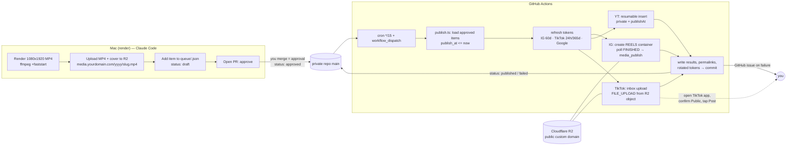

# Automating Reels / TikTok / Shorts publishing from a self-built queue (no paid scheduler)

Research date: 2026-11-01. Scope: 9:16 MP4, 45–60 s, 1 upload/day-ish, solo developer (Node/Python, GitHub Actions, Claude Code), human approval gate, $0 third-party scheduler spend.

> **Headline findings**
> 1. **Instagram and YouTube are fully automatable for your own account with zero paid services and no app review.** Instagram: "Instagram API with Instagram Login", Standard Access, 60-day refreshable token. YouTube: unverified OAuth app is fine for <100 users; the old "unverified projects upload private" rule is gone, and `videos.insert` now costs 1 unit in its own 100-uploads/day bucket.
> 2. **TikTok is the problem.** Unaudited apps can only post `SELF_ONLY`, *and* the posting account must be private at post time. TikTok's own guidelines list "a utility to upload to accounts you/your team manage" and "apps for private or personal use" as *not approvable*. Realistic options: (a) **Upload-to-inbox** (video lands in your TikTok drafts, you tap Post in the app = your approval gate), or (b) pay ~$24–29/mo for a hosted API with a pre-audited TikTok app for TikTok only.
> 3. **Recommended scheduler:** private GitHub repo as queue + Cloudflare R2 (free tier) on a custom domain for public MP4 URLs + GitHub Actions cron (every 15 min) + PR-merge/`status: approved` as the gate. YouTube uses native `publishAt`; Instagram publishes at cron time; TikTok gets an inbox upload.

---

## 1. Instagram Reels

### 1.1 Which API: Instagram Login vs Facebook Login

Meta now exposes the same Instagram Platform through three login flavors. The one to use for a solo creator/business account is **Instagram API with Instagram Login** ("Business Login for Instagram"):

| | Instagram Login | Facebook Login (for Business) |
|---|---|---|
| Facebook Page required | No | Yes (IG account must be linked to a Page) |
| Host | `graph.instagram.com` | `graph.facebook.com` (+ `rupload.facebook.com`) |
| Token | Instagram User access token | Facebook Page access token |
| Scopes for publishing | `instagram_business_basic`, `instagram_business_content_publish` | `instagram_basic`, `instagram_content_publish`, `pages_read_engagement` |
| Content publishing / insights / comments | Yes | Yes |
| Hashtag search, product tagging, partnership ads, resumable uploads | No | Yes |
| Collaborators on Reels | Not listed | Yes |

Resumable (binary) upload is only available on the Facebook Login path; with Instagram Login you must supply a **public `video_url`**. For a 45–60 s MP4 (~20–60 MB) that's fine.

Account requirement: an Instagram **professional** account. Creator accounts have been supported for publishing since June 2023 (previously Business only). If a publish call is rejected on a Creator account, switching to Business is the usual fix.

### 1.2 Access level and app review (what works for your own account)

- **Standard Access is enough** if the app only serves Instagram professional accounts you own or manage and that are added to the app. No App Review, no Business Verification.
- **Advanced Access** (App Review + Business Verification) is only needed to serve accounts you don't own.
- Practical gotchas when generating a token in the App Dashboard:
  - In Development mode, token generation only works for accounts that hold an app role (**Instagram Tester**: App roles → Roles → Instagram testers → invite your username → accept in Instagram under Settings → Apps and websites → Tester invites).
  - If your IG account belongs to the same Meta Business that owns the app you can't add it as a tester; instead set a Privacy Policy URL + Category under App settings → Basic and **Publish** the app to Live. Own-account Standard Access still needs no review.
  - Add `instagram_business_content_publish` under Permissions and features, then regenerate the token so it includes the publish scope (the default dashboard token covers messaging/basic only).
- Use case to add: "Manage messaging & content on Instagram" → Customize → "API setup with Instagram login" (its app ID/secret differ from the Facebook app's).

### 1.3 Tokens

- Authorization code: valid 1 hour, single use. Short-lived token → exchange for **long-lived token (60 days)**.
- Refresh: `GET https://graph.instagram.com/refresh_access_token?grant_type=ig_refresh_token&access_token=...`. Conditions: token is ≥24 h old, not expired, user granted `instagram_business_basic`. Each refresh extends another 60 days; an expired token cannot be refreshed. **Refresh on every publish run and persist the new token.**
- Old `business_*` scope names were cut off 2025-01-27; use `instagram_business_*`.

### 1.4 Reels publishing flow

1. **Create container**: `POST /{ig_user_id}/media` with `media_type=REELS`, `video_url=<public https URL>`, optional `caption`, `cover_url` or `thumb_offset`, `share_to_feed`, `audio_name`, `collaborators` (≤3), `user_tags`, `location_id`, `is_ai_generated` (added 2026-06-22), `trial_params` (Trial Reels, added 2025-12-03). Returns a container ID.
2. **Poll**: `GET /{container_id}?fields=status_code` → `IN_PROGRESS` | `FINISHED` | `ERROR` | `EXPIRED` | `PUBLISHED`. Meta recommends polling once a minute for up to 5 minutes. Only publish when `FINISHED`.
3. **Publish**: `POST /{ig_user_id}/media_publish` with `creation_id=<container_id>` → returns the IG Media ID. If no ID is returned, re-check the container status (it may already be `PUBLISHED`).
4. **Verify**: `GET /{media_id}?fields=permalink,media_product_type`. A published reel reports `media_type=VIDEO`; use `media_product_type` to confirm it's a reel.

**Public URL rules**: media "must be hosted on a publicly accessible server at the time of the attempt." Community experience (n8n thread) is that Meta wants a direct link to the raw file with correct `Content-Type: video/mp4`, no auth tokens, no HTML wrapper, no redirects. Google Drive links fail with "Media download has failed. The media URI doesn't meet our requirements."

Hosting options assessed:

| Host | Works for IG `video_url` | Works for TikTok `PULL_FROM_URL` | Notes |
|---|---|---|---|
| **Cloudflare R2 public bucket on custom domain** | Yes | Yes (verify your domain via DNS TXT) | Free 10 GB / 1M Class A / 10M Class B per month, egress free. `r2.dev` subdomain is rate-limited and "development only"; use a custom domain (zone must be on the same Cloudflare account). |
| S3 public-read object (or CloudFront) | Yes | Only with your own domain in front | Cents/month at this volume. |
| GitHub release asset | Probably (302 → `objects.githubusercontent.com`; verified with curl) — untested against Meta's redirect rule | **No** (redirects forbidden, can't verify github.com) | Free, but relies on redirects. |
| GitHub Pages on a custom domain | Yes (direct file, correct MIME) | Yes if you verify the domain | 100 MB/file, 1 GB site, soft 100 GB/mo bandwidth; files live in git history forever. |
| Temporary tunnel (cloudflared/ngrok) from Mac | Yes while Mac is up | Only on a verified, stable hostname | Fragile; Meta fetches at container-create time and may re-fetch. |

### 1.5 Limits

- **Publishing quota**: the `content_publishing_limit` reference says `quota_total` is "currently 50" containers per 86,400 s rolling window; the content-publishing guide page says 100 (and 50 for carousels). Treat 50/24 h as the safe number; check `GET /{ig_user_id}/content_publishing_limit?fields=quota_usage,config` before publishing. Limit is enforced on `media_publish`.
- **Containers**: 400 created per rolling 24 h; each expires after 24 h if unpublished.
- **Caption**: 2,200 chars, ≤30 hashtags, ≤20 @mentions.
- **Reels video spec**: MP4/MOV, moov atom at front, no edit lists; H.264 or HEVC, progressive, closed GOP, 4:2:0; AAC ≤48 kHz mono/stereo at 128 kbps; 23–60 fps; max 1920 px wide; aspect 0.01:1–10:1 (9:16 recommended); VBR ≤25 Mbps; 3 s–15 min; ≤300 MB.
- **Cover**: `cover_url` (JPEG ≤8 MB, sRGB; centre 9:16 crop if not 9:16) overrides `thumb_offset` (ms, default 0).
- **`share_to_feed`**: `true` = Feed + Reels tab, `false` = Reels only; neither guarantees Reels-tab placement.
- **No native scheduling in the API.** Meta only says apps that let users schedule must enforce the publishing limit themselves. Containers expiring at 24 h means you cannot "pre-create" far ahead; create the container at publish time (or ≤ a few hours before).
- Encode with `ffmpeg -movflags +faststart` to satisfy the moov-atom rule.

---

## 2. TikTok Content Posting API

### 2.1 Two modes

| | Direct Post (`/v2/post/publish/video/init/`) | Upload to inbox (`/v2/post/publish/inbox/video/init/`) |
|---|---|---|
| Scope | `video.publish` | `video.upload` |
| Result | Published to profile with the `privacy_level` you send | Video lands in the creator's TikTok inbox/drafts; creator must tap the notification and finish the post in the app (caption/privacy chosen in-app) |
| Audit needed for public visibility | **Yes** | The official page has no unaudited/private wording; third-party docs describe it as the lower bar. Treat as "works, but confirm in sandbox" |
| Pending limit | ~15 posts/creator/24 h shared across all Direct Post clients | ≤5 pending shares per 24 h (`spam_risk_too_many_pending_share`) |
| Rate limit | 6 requests/min per user access token (HTTP 429 `rate_limit_exceeded`) | same |

### 2.2 The unaudited-client rule (verbatim-level precision)

From the Content Sharing Guidelines:
- Unaudited clients can only post with `SELF_ONLY` viewership.
- Unaudited clients can allow up to 5 users to post in a 24-hour window.
- All user accounts posting through an unaudited client must be set to **private at the time of posting**.
- Error code: `unaudited_client_can_only_post_to_private_accounts`.
- Posts made while unaudited stay private after the audit passes (per bundle.social's write-up) and must be re-created.

**What TikTok says is *not* acceptable** (same page): an app that copies arbitrary content from other platforms to TikTok; and "a utility tool to help upload contents to the account(s) you or your team manages." The App Review Guidelines add that apps "for private or personal use" are not approved, the website URL must be a fully developed site (not a landing/login page) with visible Privacy Policy and ToS links, and first-time submissions must demonstrate the integration in a sandbox with 1–5 demo videos (≤50 MB each) showing the full flow.

**Consequence for a solo dev:** an honest "post my own queue to my own account" app does not meet TikTok's stated audit criteria. The two-stage path (product access in days → content audit in weeks) is designed for consumer-facing products that render a composer from `creator_info/query`, show a privacy dropdown with no default, un-ticked Duet/Stitch/Comment boxes, the Music Usage Confirmation, a preview, and an explicit consent click before upload.

### 2.3 Sandbox

- Up to 5 sandboxes per app, each shareable with up to 10 target TikTok accounts; no app review needed to use it.
- In sandbox, Direct Post is forced to `SELF_ONLY` and only target users can authorize. You can add your own account as a target user.

### 2.4 Media transfer

- **FILE_UPLOAD**: `init` returns an `upload_url` valid 1 hour; `PUT` chunks with `Content-Range`. Chunks 5–64 MB (final chunk up to 128 MB); files <5 MB go in one request with `chunk_size = file size`; files >64 MB must be split; max 1,000 chunks, sent sequentially; 206 = more expected, 201 = complete; retry on 5xx; 403 = URL expired. A 45–60 s MP4 is normally one chunk.
- **PULL_FROM_URL**: HTTPS, **no redirects**, URL must stay reachable for up to 1 hour, and the domain or URL prefix must be verified in the developer portal (DNS signature record recommended; domain verification covers subdomains; prefix verification is exact-match). Otherwise `url_ownership_unverified`.
- Video spec: MP4 (recommended)/WebM/MOV; H.264 recommended (H.265, VP8, VP9 accepted); 23–60 fps; 360–4096 px each dimension; ≤4 GB; up to 10 min via the API (creator's own max applies, check `max_video_post_duration_sec`).

### 2.5 Post metadata (Direct Post)

`privacy_level` (required; must be one of the values returned by `creator_info/query`: `PUBLIC_TO_EVERYONE`, `MUTUAL_FOLLOW_FRIENDS`, `FOLLOWER_OF_CREATOR`, `SELF_ONLY`), `title` (≤2,200 UTF-16 code units; hashtags/mentions parsed), `disable_duet` / `disable_stitch` / `disable_comment`, `video_cover_timestamp_ms`, `brand_content_toggle` (paid partnership), `brand_organic_toggle` (your own brand), `is_aigc`. No scheduling parameter exists in the API. Status: poll `POST /v2/post/publish/status/fetch/` with `publish_id`.

### 2.6 Tokens

Access token 24 h (`expires_in` 86400); refresh token 365 days (`refresh_expires_in` 31536000). Refresh at `POST https://open.tiktokapis.com/v2/oauth/token/` with `grant_type=refresh_token`; **the response may contain a new `refresh_token` — persist it immediately**, the old one may stop working. Revoke at `/v2/oauth/revoke/`. Web apps need an HTTPS redirect URI (a loopback `http://127.0.0.1:*/` desktop redirect is accepted for CLI-style auth). App review (not the content audit) is quoted at "several days to two weeks."

### 2.7 Realistic TikTok options ranked

1. **Inbox upload (semi-automatic, $0).** Your pipeline uploads the approved MP4 to your inbox; you open TikTok, the caption/hashtags are pre-filled, you pick Public and tap Post. Tapping Post *is* the approval gate. Keep ≤5 pending. Verify in sandbox first that inbox uploads from your unaudited app surface normally in the app (official docs are silent; medium confidence).
2. **Direct Post `SELF_ONLY` + manual flip ($0).** Only works if your account is private at post time, so unusable for a public creator account. Not recommended.
3. **Hosted API for TikTok only ($24–29/mo).** Upload-Post Basic ($24/mo; the free tier returns 403 for TikTok), Blotato Starter ($29/mo, API included). Their TikTok apps are already audited. Breaks the "$0" rule but only for one platform.
4. **Attempt the audit anyway.** Needs a public-facing product page, demo videos of a compliant composer UI, and a plausible multi-user story. Weeks, and the guidelines say personal-use tools are rejected. Low probability; don't block on it.

---

## 3. YouTube Data API v3 (Shorts)

### 3.1 Quota — the rules changed in 2025/2026

Current official text (Getting Started, last updated 2026-10-15): projects get **100 `search.list` calls, 100 `videos.insert` calls, and 10,000 units/day for all other endpoints**. The `videos.insert` reference now says: cost of **1 unit in the Video Uploads quota bucket**, "Quota impact: 100 calls per day." The old math (1,600 units → ~6 uploads/day) is obsolete. A community write-up dates the drop to Dec 2025 with separate buckets from 2026-06-01. Other costs: `thumbnails.set` 50 units, writes generally 50. Quota resets midnight Pacific. Audit + quota-extension form only matters if you need >100 uploads/day.

### 3.2 Unverified app restriction — current rule

The `videos` and `videos.insert` reference pages now state explicitly that videos uploaded from unverified API projects are **not** restricted to private viewing mode. (The July-2020 "locked private until audit" rule no longer appears in the docs.) Separately, Google's OAuth verification FAQ says apps for personal use with <100 users do **not** need verification; users click through the "unverified app" warning. So for a single-channel tool: no YouTube API compliance audit and no OAuth brand/scope verification are required.

### 3.3 OAuth consent screen: put it "In production"

A project with External user type and publishing status **Testing** issues refresh tokens that **expire after 7 days** — a scheduled uploader dies every week with `invalid_grant`. Set the app to **In production** (unverified is fine for personal use; 100-user cap applies). Other refresh-token death conditions: 6 months unused, user revoked, >100 refresh tokens per Google account per client (oldest invalidated). Request only `https://www.googleapis.com/auth/youtube.upload` (plus `youtube.force-ssl` or `youtube` if you need `thumbnails.set` / later edits).

### 3.4 Upload and scheduling

- Endpoint `POST https://www.googleapis.com/upload/youtube/v3/videos?uploadType=resumable&part=snippet,status`. Max 256 GB; MIME `video/*`. Use the resumable protocol (initiate → PUT bytes; resume with `Content-Range: bytes */total` on failure).
- **Native scheduling exists**: set `status.privacyStatus=private` and `status.publishAt=<ISO 8601>`; it can only be set when the video is private and never published. YouTube flips it public at that time. This makes YouTube immune to cron jitter: upload at approval time with `publishAt`.
- `snippet.title` ≤100 chars; `description` ≤5,000 bytes; `tags` ≤500 chars total; `status.selfDeclaredMadeForKids` must be set; `notifySubscribers` optional.
- **Shorts detection**: no flag, no endpoint. YouTube classifies by shape and length: vertical or square and ≤3 minutes. `#Shorts` in title/description is not required (community reports it sometimes helps). Upload at 1080×1920.
- Thumbnails via `thumbnails.set` (50 units; channel must be phone-verified); low value for Shorts.

---

## 4. Cross-posting the same native MP4 to all three

- **Instagram** (2021 policy, still the operative statement): Reels that are low-res or "visibly recycled from other apps" — i.e., carrying another app's logo/watermark — are made less discoverable in Reels-tab recommendations (not demoted to followers). Native, sharp, un-watermarked uploads are what they ask for.
- **TikTok**: apps must not add brand names, logos, watermarks, promotional branding or links to content they post; TikTok also lists "copies arbitrary content from other platforms" as an unacceptable app purpose. Your own original video, uploaded clean, is fine.
- **YouTube**: Shorts posted elsewhere remain eligible for monetization programs as long as they are your original work; videos carrying another platform's watermark are not. YouTube itself adds a watermark when *you download* a Short, so never re-download from one platform to upload to another.

**Bottom line:** render once, un-watermarked, 1080×1920 H.264/AAC `+faststart`, and upload that same master natively to each API. Use per-platform captions (TikTok hashtags inline in `title`; IG ≤30 hashtags; YT title ≤100 chars). Don't let any platform's download be the source for another.

---

## 5. Hosted "post anywhere" APIs (fallback) and open-source self-hosted tools

| Option | Cost | TikTok/IG/YT | Notes |
|---|---|---|---|
| **Ayrshare** | $149/mo Premium (no free plan; 28-day trial on Launch) | Yes | Unlimited posts/API calls; overkill here. |
| **Upload-Post** | Free: 10 uploads/mo, **TikTok blocked (403)**. Basic $24/mo (unlimited, platform caps apply) | Yes on paid | Simplest paid escape hatch for TikTok only. |
| **Blotato** | Starter $29/mo (API + MCP on all paid plans; trial has no API) | Yes | 20 accounts, 200 queued posts, 400 MB upload. |
| **Postiz (self-hosted)** | $0 software (AGPL-3.0, ~40k stars); needs Postgres + Redis + Temporal, 2–4 vCPU / 4–8 GB RAM | Yes — **but you bring your own developer apps** | Has a public REST API (`POST /public/v1/posts`, `/upload`, 90 req/h default). Its TikTok doc confirms: unaudited → forced `SELF_ONLY`, 5 users/24 h, accounts private; needs HTTPS + verified media domain (R2 suggested). Does not solve the TikTok audit; adds a heavy stack for one user. |
| **Mixpost (self-hosted)** | Lite (free) = Facebook Pages, X, Mastodon only. **Pro $299 one-time** adds IG/TikTok/YT (internal use) | Only Pro | Same bring-your-own-app and TikTok audit problem. |
| **keryx** (Go CLI, gitlab.com/phpboyscout/keryx) | $0 | IG/YT/TikTok (+6 more) | Single binary, stateless (your git repo holds config/schedule), designed for pipeline runs. Early-stage; its own TikTok guide reaches the same conclusion (SELF_ONLY until audited). Worth reading as a reference implementation. |

Verdict: none of the self-hosted tools removes the TikTok audit wall, because the audit attaches to *your* developer app. Hosted services carry their own audited apps, which is what you pay for.

---

## 6. Scheduler architectures with no paid service

| | (a) GitHub Actions cron | (b) Claude cloud scheduled task | (c) Mac launchd / $4–5 VPS | (d) Cloudflare Workers cron + R2 |
|---|---|---|---|---|
| **Timing reliability** | Delayed "during periods of high load" (minutes; worst case tens of minutes at :00). Min 5 min. Default branch only. Public repos: disabled after 60 days without activity (use a private repo). | Min interval 1 hour; runs on the hour "can start several minutes late"; research preview, behavior may change; 100 scheduled runs/hour/account. | launchd: exact, but Mac must be awake (use `pmset repeat wake` / `caffeinate`). VPS (Hetzner CX22 ≈ €4/mo or Oracle Always-Free): exact, always on. | Exact to the minute; 5 cron triggers/account free; 15-min wall clock, 10 ms CPU per cron (I/O wait is free so API calls are OK). |
| **Secrets** | Encrypted repo secrets; but **rotated tokens** (IG refresh, TikTok new refresh token) must be written back: either `gh secret set` with a PAT or commit an `age`/`sops`-encrypted `tokens.enc.json`. | Env vars are visible to anyone using the environment; use network secrets. Default network allowlist blocks `graph.instagram.com` etc. — switch the environment to Custom/Full. | OS keychain / `.env` with 600 perms. Simplest rotation story (write file). | Worker secrets + KV for rotating tokens. |
| **Public MP4 URL** | Not from Actions itself → R2 (or S3/GitHub Pages). | Same. | VPS can serve it via nginx on your domain (also TikTok-verifiable). | R2 is native; custom domain on same CF account. |
| **Approval gate mapping** | **PR merge = approval**, or Claude Code flips `status: approved` and commits. Full audit trail in git. | Claude task reads queue, could ask you in chat; weaker gate. | Any: file edit, Notion checkbox polled, CLI `approve <id>`. | Worker reads queue from KV/R2; approval via a tiny authenticated `/approve` endpoint or editing the JSON in the repo + deploy. |
| **Claude Code fit** | Excellent (repo-native; `workflow_dispatch` for manual runs). | Good, but 1-hour granularity and preview status. | Fine. | More plumbing (Worker code, KV, streaming R2→YouTube resumable). |
| **Cost** | $0 (private repo minutes are plentiful for a 1-min job/15 min ≈ 2,900 min/mo; free tier is 2,000 for private repos — run every 30 min or do YT via publishAt and IG only at the few slots you post) | Included in Max plan | $0 (Mac) / ~$4–5 (VPS) | $0 |

Mitigations that make GitHub Actions "good enough" for a 1-post/day cadence:
- YouTube: upload at approval with `publishAt` → exact timing, no cron dependency.
- Instagram: has no scheduling, so it publishes at the first cron tick after `publish_at`; schedule slots at :07/:37 (not :00) and accept ±15 min. If exact timing matters, move only the IG publish step to a Cloudflare Worker cron.
- TikTok inbox upload: timing irrelevant; you post from the app.
- Add a `workflow_dispatch` input (`item_id`) for manual retries.

---

## 7. Recommended architecture



Approval gate: **PR merge** (branch protection on `main`, you are the only reviewer). Claude Code prepares the branch (`queue/2026-11-03-foo.json` with `status: approved` and the R2 URLs) and opens the PR with the MP4 link in the body so you can watch it before merging. Fallback gate without a PR: edit `status` in the file and push.

### 7.1 Queue data model (`queue/<id>.json`, one file per item to avoid merge conflicts)

```json
{
  "id": "2026-11-03-why-nvme-is-fast",
  "status": "approved",                 
  "created_at": "2026-11-01T20:12:00Z",
  "approved_by": "kyle",
  "approved_at": "2026-11-02T14:03:11Z",
  "publish_at": "2026-11-03T13:07:00-05:00",
  "media": {
    "video_url": "https://media.example.com/2026/11/why-nvme-is-fast.mp4",
    "cover_url": "https://media.example.com/2026/11/why-nvme-is-fast.jpg",
    "r2_key": "2026/11/why-nvme-is-fast.mp4",
    "sha256": "…",
    "duration_s": 52.4,
    "width": 1080, "height": 1920, "bytes": 38211234
  },
  "copy": {
    "hook_title": "Why NVMe is so fast",
    "instagram": { "caption": "… ≤2200 chars, ≤30 #, ≤20 @", "share_to_feed": true, "thumb_offset_ms": 1200 },
    "youtube":   { "title": "Why NVMe is so fast (≤100 chars)", "description": "…", "tags": ["nvme","ssd"], "category_id": "28", "made_for_kids": false },
    "tiktok":    { "title": "Why NVMe is so fast #tech #nvme", "privacy_level": "PUBLIC_TO_EVERYONE", "disable_duet": false, "disable_stitch": false, "disable_comment": false, "is_aigc": false }
  },
  "targets": {
    "instagram": { "enabled": true,  "state": "pending", "attempts": 0, "container_id": null, "media_id": null, "permalink": null, "last_error": null, "next_retry_at": null },
    "youtube":   { "enabled": true,  "state": "pending", "attempts": 0, "video_id": null, "publish_at_set": null, "last_error": null, "next_retry_at": null },
    "tiktok":    { "enabled": true,  "mode": "inbox", "state": "pending", "attempts": 0, "publish_id": null, "last_error": null, "next_retry_at": null }
  }
}
```

`status` lifecycle: `draft → approved → publishing → published | partial | failed | cancelled`. Per-target `state`: `pending → uploading → processing → published | failed | skipped`. Tokens live outside the queue (`secrets/tokens.enc.json`, age-encrypted with a key in a repo secret, or in GitHub secrets updated via `gh secret set`).

### 7.2 Per-platform publish steps (as the Action executes them)

**Common pre-flight**: verify R2 object exists and `HEAD` returns `200` + `video/mp4` with no redirect; check sha256 matches; load/refresh tokens.

**Instagram**
1. `GET /{ig_id}/content_publishing_limit?fields=quota_usage` → abort if ≥ 50.
2. `POST /{ig_id}/media` `{media_type:"REELS", video_url, caption, share_to_feed, cover_url|thumb_offset}` → `container_id` (persist immediately so a crashed run can resume).
3. Poll `status_code` every 30–60 s, up to ~10 min. `FINISHED` → step 4. `ERROR` → fail with `status` text. `IN_PROGRESS` past the timeout → leave `state: processing`, retry next tick (container valid 24 h).
4. `POST /{ig_id}/media_publish` `{creation_id}` → `media_id`. If the call errors without ID, re-read the container; `PUBLISHED` means success.
5. `GET /{media_id}?fields=permalink` → store.
6. Refresh the long-lived token if it is >24 h old (idempotent); persist.

**YouTube** (run at *approval*, not at publish time)
1. Ensure refresh token works (`invalid_grant` → open an issue; the OAuth client is probably back in Testing or revoked).
2. Resumable initiate with `part=snippet,status`, body: `snippet{title, description, tags, categoryId}`, `status{privacyStatus:"private", publishAt, selfDeclaredMadeForKids:false}`, `notifySubscribers` as you prefer.
3. Stream the bytes from R2 (or the local file on Mac). On network failure, query `Content-Range: bytes */N` and resume.
4. Store `video_id`; mark `state: scheduled`. Optional later check: `videos.list` (1 unit) to confirm `privacyStatus` flipped to `public` after `publishAt`.
5. Shorts: nothing extra; vertical ≤3 min does it. Optionally add `#Shorts` to the description.

**TikTok (inbox mode)**
1. Refresh access token (24 h); persist any new refresh token *before* doing anything else.
2. `POST /v2/post/publish/creator_info/query/` → confirm `max_video_post_duration_sec` ≥ duration.
3. `POST /v2/post/publish/inbox/video/init/` with `source_info{source:"FILE_UPLOAD", video_size, chunk_size=video_size, total_chunk_count:1}` (files <64 MB) — or `PULL_FROM_URL` with the R2 URL once `media.example.com` is verified in the TikTok portal.
4. `PUT upload_url` with `Content-Range: bytes 0-(N-1)/N`; expect 201. Retry on 5xx; 403 = re-init (URL expired after 1 h).
5. Poll `/v2/post/publish/status/fetch/` until `SEND_TO_USER_INBOX` (or equivalent terminal state), store `publish_id`, set `state: awaiting_in_app`.
6. The Action comments on the PR / opens an issue: "TikTok draft ready — open app, confirm Public, tap Post." Keep ≤5 pending.

### 7.3 Failure handling and retries

- **Idempotency**: persist every platform ID the moment it's returned (container_id, upload_url session, video_id, publish_id) and commit before continuing; on the next tick, resume from the recorded state instead of re-creating (prevents double posts). Use a repo-level lock (`concurrency: publish` in the workflow) so two ticks never run concurrently.
- **Retry policy**: exponential backoff per target, `attempts ≤ 5`, `next_retry_at` stored in the item; never retry `media_publish` after a success-looking failure without re-reading the container.
- **Classify errors**: 401/`invalid_grant`/`access_token_invalid` → stop that platform, open issue (human needed). 429/`rate_limit_exceeded`/`spam_risk_*` → back off ≥15 min. 4xx validation (caption too long, `url_ownership_unverified`, `privacy_level_option_mismatch`) → fail fast, no retry. 5xx/timeouts → retry.
- **Partial success**: item becomes `partial`; Action lists which targets remain; retries only those.
- **Token hygiene job** (daily, separate workflow): refresh IG token if >24 h old and <60 d; TikTok refresh; YouTube token test call (1 unit). Alert if any fails so you aren't surprised on publish day.
- **Media checks before approval**: ffprobe → 9:16, 1080×1920, H.264/AAC, ≤60 s, moov at front, ≤300 MB; reject at PR time with a CI check.
- **Observability**: every run appends to `log/YYYY-MM.jsonl` and comments on the PR; failures open a GitHub issue labelled `publish-failed`; optional push via ntfy.sh/Pushover (free/cheap).
- **Dead-man switch**: if the cron hasn't run in 2 h (GitHub delay or disabled workflow), a daily Claude cloud scheduled task (or a healthchecks.io free ping) raises an alert.

### 7.4 One-time setup checklist

**Accounts**
- [ ] Instagram account set to Professional (Creator or Business). Not required: a Facebook Page.
- [ ] YouTube channel phone-verified (needed only for custom thumbnails, harmless to do).
- [ ] TikTok account; a domain you control, with DNS on Cloudflare (for R2 custom domain + TikTok domain verification).
- [ ] A public web page with Privacy Policy and Terms (Meta needs a Privacy Policy URL to go Live; TikTok needs both visible on the site). A simple page on your existing site is enough.

**Media hosting (≈30 min)**
- [ ] Cloudflare R2 bucket; attach custom domain `media.<yourdomain>`; enable public access on the custom domain, disable `r2.dev`. Verify `curl -I` returns 200, `content-type: video/mp4`, no `location` header.
- [ ] R2 API token for uploads (Wrangler or S3-compatible SDK from the Mac/Actions).

**Meta (≈1 hour, same day)**
- [ ] developers.facebook.com → create app → use case "Manage messaging & content on Instagram" → API setup with Instagram login → note Instagram App ID/Secret.
- [ ] App settings → Basic: Privacy Policy URL + Category → Publish app Live (or add your IG account as Instagram Tester and accept invite in the IG app).
- [ ] Permissions and features: add `instagram_business_basic`, `instagram_business_content_publish`.
- [ ] Generate token for your account → exchange/confirm it's long-lived (60 d) → store encrypted. Call `/me?fields=user_id,username,account_type` to get `ig_user_id`.
- [ ] No App Review / Business Verification needed (Standard Access, own account).

**Google (≈1 hour, same day)**
- [ ] Cloud project → enable YouTube Data API v3 → OAuth consent screen: External, add scope `youtube.upload` (and `youtube.force-ssl` only if you'll edit/thumbnail), publishing status **In production** (click through "unverified app"; no verification needed for <100 users).
- [ ] Create OAuth client (Desktop or Web) → run a one-time local consent flow → store refresh token encrypted.
- [ ] Confirm quota page shows the 100/day `videos.insert` bucket. No compliance audit needed unless you need more.

**TikTok (same day to get working; weeks and uncertain for public Direct Post)**
- [ ] developers.tiktok.com → create app (web platform, HTTPS redirect URI; or a loopback `http://127.0.0.1:*/` desktop redirect) → add Login Kit + Content Posting API.
- [ ] Add a **Sandbox**; add your TikTok account as a target user; request `user.info.basic`, `video.upload` (inbox) and `video.publish` (for later).
- [ ] URL properties: verify `media.<yourdomain>` via DNS TXT if you want `PULL_FROM_URL`; otherwise use `FILE_UPLOAD`.
- [ ] Do the OAuth flow once; store refresh token (365 d); implement rotation.
- [ ] Test inbox upload → confirm the draft appears in the TikTok app and can be posted Public. Document the 5-pending limit.
- [ ] *Optional, low-odds:* submit app review (ToS/Privacy on a real site, demo videos) → product access typically days → content audit **weeks** with no published SLA; expect rejection for a single-user utility. Decide at that point whether $24–29/mo for a hosted TikTok-only route is worth it.

**Repo & Actions (≈half a day)**
- [ ] Private repo `publish-queue`: `queue/`, `log/`, `scripts/publish.ts`, `.github/workflows/publish.yml` (`schedule: "7,22,37,52 * * * *"`, `workflow_dispatch`, `concurrency: publish`), `.github/workflows/tokens.yml` (daily).
- [ ] Secrets: `AGE_KEY` (decrypts `secrets/tokens.enc.json`), `IG_APP_SECRET`, `TIKTOK_CLIENT_SECRET`, `GOOGLE_CLIENT_SECRET`, `R2_*`, optional `GH_PAT` if you prefer `gh secret set` for rotation.
- [ ] Branch protection on `main` requiring your review → PR merge is the approval.
- [ ] CI check on PRs: ffprobe spec validation + caption length lints.
- [ ] Claude Code skill: "queue this render" (upload to R2, write item, open PR with preview link).

**Realistic timeline**: Instagram and YouTube publishing end-to-end in a weekend. TikTok inbox mode the same weekend. Public TikTok Direct Post from your own app: weeks *if* approved; plan as if it won't be.

---

## Sources

Instagram / Meta
- https://developers.facebook.com/documentation/instagram-platform/content-publishing
- https://developers.secure.facebook.com/docs/instagram-platform/instagram-api-with-instagram-login/content-publishing
- https://developers.facebook.com/documentation/instagram-platform/instagram-graph-api/reference/ig-user/media
- https://developers.facebook.com/documentation/instagram-platform/instagram-graph-api/reference/ig-user/content_publishing_limit
- https://developers.facebook.com/documentation/instagram-platform/instagram-api-with-instagram-login/business-login.md
- https://developers.facebook.com/documentation/instagram-platform/overview
- https://developers.secure.facebook.com/documentation/instagram-platform/changelog
- https://developers.facebook.com/documentation/instagram-platform/content-publishing/resumable-uploads
- https://keryx.phpboyscout.uk/how-to/instagram-credentials/
- https://community.n8n.io/t/instagram-facebook-graph-api-google-drive-links-are-no-longer-accepted-resolved/165635
- https://www.socialmediatoday.com/news/meta-expands-instagram-api-creator-accounts-user-tagging-reels/652762/
- https://tubefilter.com/2021/02/10/instagram-reels-with-tiktok-watermark-less-discoverable/
- https://www.thetechoutlook.com/new-release/software-apps/instagram-to-add-algorithm-that-will-stop-tiktok-video-watermark-on-reels/

TikTok
- https://developers.tiktok.com/doc/content-sharing-guidelines
- https://developers.tiktok.com/docs/en/content-sharing-guidelines
- https://developers.tiktok.com/doc/content-posting-api-reference-direct-post
- https://developers.tiktok.com/doc/content-posting-api-reference-upload-video
- https://developers.tiktok.com/doc/content-posting-api-media-transfer-guide
- https://developers.tiktok.com/doc/content-posting-api-get-started
- https://developers.tiktok.com/doc/oauth-user-access-token-management
- https://developers.tiktok.com/docs/en/getting-started-faq
- https://developers.tiktok.com/docs/en/app-review-guidelines
- https://developers.tiktok.com/blog/introducing-sandbox
- https://bundle.social/blog/tiktok-api-approval
- https://adaptlypost.com/blog/why-does-my-app-need-approval-post-tiktok
- https://docs.postiz.com/self-host/providers/tiktok
- https://keryx.phpboyscout.uk/how-to/tiktok-credentials/
- https://kineclip.com/blog/tiktok-inbox-draft-publishing-explained-2026/
- https://postfa.st/api-guides/tiktok/draft-mode

YouTube / Google
- https://developers.google.com/youtube/v3/docs/videos/insert
- https://developers.google.com/youtube/v3/docs/videos
- https://developers.google.com/youtube/v3/getting-started
- https://developers.google.com/youtube/v3/guides/quota_and_compliance_audits
- https://developers.google.com/identity/protocols/oauth2
- https://support.google.com/cloud/answer/13464323?hl=en
- https://support.google.com/youtube/answer/10059070?hl=en
- https://dev.to/aipredictions_dev/youtube-now-counts-uploads-in-their-own-bucket-100-a-day-one-unit-each-29gm
- https://bundle.social/blog/youtube-shorts-api-secrets
- https://www.ayrshare.com/solutions/google-api-error-403-unverified-app-how-to-fix-the-audit-pipeline.md
- https://digiday.com/future-of-tv/youtubes-creator-fund-for-youtube-shorts-will-not-exclude-videos-posted-to-other-platforms

Hosted APIs / open-source tools
- https://www.ayrshare.com/pricing.md
- https://docs.upload-post.com/resources/pricing-and-limits
- https://www.blotato.com/pricing.md
- https://github.com/gitroomhq/postiz-app
- https://docs.postiz.com/public-api
- https://docs.postiz.com/self-host/installation/system-requirements
- https://mixpost.app/pricing
- https://keryx.phpboyscout.uk/

Scheduling / hosting infrastructure
- https://docs.github.com/en/actions/writing-workflows/choosing-when-your-workflow-runs/events-that-trigger-workflows
- https://code.claude.com/docs/en/scheduled-tasks
- https://code.claude.com/docs/en/routines.md
- https://developers.cloudflare.com/workers/platform/limits/
- https://developers.cloudflare.com/r2/pricing/
- https://developers.cloudflare.com/r2/buckets/public-buckets/index.md
